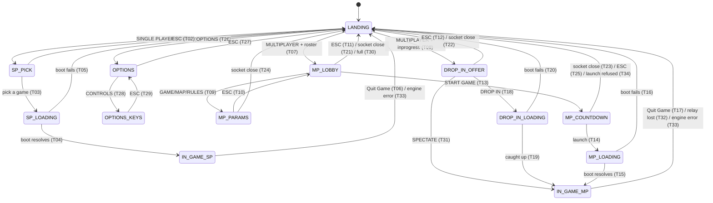

# webdoom lobby state machine

This is the launcher's state machine: what the browser shows from page load
until the engine is running, and how it gets back. It lives in
`client/js/lobby.js`, `menu.js` and `countdown.js`. The engine's own menus
(`m_menu.c`, inside wasm) are a separate machine; see the boundary note at the
end. The network side of the multiplayer states is in [netcode.md](netcode.md).

Each transition has a T-id. Tests cite these ids in their assertion messages,
so a failing test names the edge it broke.

## State encoding

There is no single state variable. The state is read from four module-scope
values in `lobby.js` and two UI objects:

| value | what it encodes |
|---|---|
| `booted` (boolean) | false: the launcher is showing. true: an engine is booting or running |
| `lobby` (null or socket api) | null: no `/ws/lobby` connection |
| `roster` (null or message) | the latest `roster` (a lobby is forming) |
| `ipSummary` (null or message) | the latest `inprogress` (a game is already live) |
| `menu.current()?.id`, `menu.depth()` | which launcher screen is on top of the menu stack |
| `#countdown` | whether the countdown overlay is visible |

`booted` is set by `enterGame()` before `bootDoom()` starts, so a second boot
cannot begin while one is in flight. `resetToLauncher()` clears all four values.

## States

| # | state | `booted` | `lobby` | `roster` | `ipSummary` | screen | countdown |
|---|---|---|---|---|---|---|---|
| 1 | **LANDING** | false | null | null | null | `root` (depth 1) | hidden |
| 2 | **SP-PICK** | false | null | null | null | `sp` (depth ≥ 2) | hidden |
| 3 | **SP-LOADING** | true | null | null | null | hidden (loading bar) | hidden |
| 4 | **IN-GAME-SP** | true | null | null | null | hidden | hidden |
| 5 | **MP-LOBBY** | false | live | set | null | `lobby` (depth ≥ 2) | hidden |
| 6 | **MP-PARAMS** | false | live | set | null | a picker (depth ≥ 3) | hidden |
| 7 | **MP-COUNTDOWN** | false | live | set | null | `lobby`, still shown | visible |
| 8 | **MP-LOADING** | true | live | set | null | hidden | GO, then hidden |
| 9 | **IN-GAME-MP** | true | closed | – | – | hidden | hidden |
| 10 | **DROP-IN-OFFER** | false | live | null | set | `inprogress` | hidden |
| 11 | **DROP-IN-LOADING** | true | live | null | set | hidden (catch-up bar) | hidden |
| 12 | **OPTIONS** | false | null | null | null | `options` (depth 2) | hidden |
| 13 | **OPTIONS-KEYS** | false | null | null | null | `controls` (depth 3) | hidden |
| 14 | **MP-CONNECTING** | false | live | null | null | `connecting` (depth 2) | hidden |

In IN-GAME-MP the lobby socket has been closed (the game runs on `/ws/game` or
`/ws/spectate`), and `roster` and `ipSummary` keep whatever they held until the
return to the launcher clears them. Nothing reads them in game.

## Transitions

### User actions

| ID | from | to | trigger |
|---|---|---|---|
| T01 | LANDING | SP-PICK | SINGLE PLAYER |
| T02 | SP-PICK | LANDING | ESC / back (stack pop) |
| T03 | SP-PICK | SP-LOADING | pick a game → `enterGame()` |
| T06 | IN-GAME-SP | LANDING | Quit Game → Y → `onQuit` → `toLauncher()` |
| T07 | LANDING | MP-LOBBY | MULTIPLAYER → MP-CONNECTING at once; `roster` replaces it |
| T08 | LANDING | DROP-IN-OFFER | MULTIPLAYER while a game is live → MP-CONNECTING; `inprogress` replaces it |
| T09 | MP-LOBBY | MP-PARAMS | GAME / MAP / RULES (MODE and SKILL step in place, no screen) |
| T10 | MP-PARAMS | MP-LOBBY | ESC / back from a picker |
| T11 | MP-LOBBY | LANDING | ESC / back → `toLauncher()` |
| T12 | DROP-IN-OFFER | LANDING | ESC / back → `toLauncher()` |
| T13 | MP-LOBBY | MP-COUNTDOWN | START GAME → server sends `countdown` 3, 2, 1 |
| T17 | IN-GAME-MP | LANDING | Quit Game → Y → `onQuit` → `toLauncher()` |
| T18 | DROP-IN-OFFER | DROP-IN-LOADING | DROP IN → `{t:'join'}` → server `welcome` + `launch` with `join` |
| T31 | DROP-IN-OFFER | IN-GAME-MP | SPECTATE → `enterGame()` with `spectate`, receive-only, no slot |
| T26 | LANDING | OPTIONS | OPTIONS |
| T27 | OPTIONS | LANDING | ESC / back (stack pop) |
| T28 | OPTIONS | OPTIONS-KEYS | CONTROLS |
| T29 | OPTIONS-KEYS | OPTIONS | ESC / back; ESC during a rebind capture cancels the capture instead, without popping |

MP-CONNECTING has its own back action: ESC there calls `toLauncher()` and
closes the socket, because a connection with no screen would hold a colour
slot nobody can see.

### Server events

| ID | from | to | event |
|---|---|---|---|
| T04 | SP-LOADING | IN-GAME-SP | `bootDoom()` resolves |
| T14 | MP-COUNTDOWN | MP-LOADING | server `launch` → GO, `enterGame()` |
| T15 | MP-LOADING | IN-GAME-MP | `bootDoom()` resolves; the lobby socket closes |
| T19 | DROP-IN-LOADING | IN-GAME-MP | catch-up reaches the frontier; the relay goes live |
| T30 | MP-LOBBY | LANDING | server `full` → `resetToLauncher(reason)`; the same handler serves MP-CONNECTING and DROP-IN-OFFER |

### Failures

| ID | from | to | event |
|---|---|---|---|
| T05 | SP-LOADING | LANDING | `bootDoom()` rejects (WAD fetch or engine failure) |
| T16 | MP-LOADING | LANDING | `bootDoom()` rejects |
| T20 | DROP-IN-LOADING | LANDING | `bootDoom()` rejects, including a stalled or refused catch-up |
| T21 | MP-LOBBY | LANDING | lobby socket closes unexpectedly: "lobby connection lost" |
| T22 | DROP-IN-OFFER | LANDING | lobby socket closes unexpectedly |
| T23 | MP-COUNTDOWN | LANDING | lobby socket closes mid-countdown; the overlay is reset |
| T24 | MP-PARAMS | LANDING | lobby socket closes while a picker is open |
| T25 | MP-COUNTDOWN | LANDING | ESC → `toLauncher()`; the overlay is reset |
| T32 | IN-GAME-MP | LANDING | the game socket closes or errors (the relay's drop of a player whose input stopped for 5 s gives its reason), the relay skips a tic, or the bundle backlog overflows; the reason is shown |
| T33 | IN-GAME-SP, IN-GAME-MP | LANDING | engine error (`I_Error`) or a throw in the frame loop; "engine error: …" is shown |
| T34 | MP-COUNTDOWN | LANDING | the `launch` carries params the client refuses; the refusal is shown |

T16 and T20 share one catch in `enterGame()`. Every failure goes through
`resetToLauncher(reason)`, which ends any running engine first, then clears the
launcher state, resets the countdown, shows the root menu and writes the
reason to the status line.

## States that cannot occur

| state | how it is prevented |
|---|---|
| countdown still visible after ESC or a socket close mid-countdown | `resetToLauncher()` calls `countdown.reset()` on every exit. `lobby` is nulled before `close()`, so the `closed` handler can tell a deliberate leave from a dropped connection, and the overlay is cleared on the synchronous path, not only in that handler |
| `booted` stuck true after a failed boot | the one catch in `enterGame()` calls `resetToLauncher()`, which clears `booted` |
| two lobby screens on the stack | the server sends exactly one of `roster` or `inprogress` at connect, and each handler only refreshes its own screen or replaces CONNECTING |
| START with zero players | the START row is always shown, and the server starts a game only when `lobby.size >= 1` |
| DROP IN while booted | `dropIn()` returns at once if `booted` or no slot is chosen |
| a second boot from a duplicate `launch` | the `launch` handler and `enterGame()` both return if `booted` |
| params changed mid-countdown | the pickers stay reachable, but the server ignores `params` once a session exists |
| a stale roster after leaving | `resetToLauncher()` nulls `roster` and `ipSummary` |
| a launcher keypress booting a second engine over a live one | `resetToLauncher()` ends the running session before it clears `booted` |

## Diagram

## Which test drives each edge

| edges | leg |
|---|---|
| T01, T02, T06–T13, T16, T20–T25, T30 | `browser-lobby` |
| T03, T04 | `browser-sp` |
| T05 | `browser-resilience` |
| T14, T15, T17 | `browser-net` |
| T18, T19, T31 | `browser-join` |
| T26–T29 | `browser-options` |
| T32 | `net-hidden` (Node clients: a client the relay drops is told why), `browser-net-hidden` (a frozen tab is dropped and its status line gives the reason) |
| T33 | `browser-ierror`, `browser-rafdeath` |
| T34 | `launch-args`, `hostile-lobby` (the refusal, below the UI) |

T20 is driven through the same catch as T16; the drop-in entry point is not
driven separately. T34 is checked at the client library, not by clicking
through the launcher; T32 is checked there and in a real tab, which reaches
the game through the launcher's MULTIPLAYER screen.

## Boundary note

Once `bootDoom()` resolves, the engine's `m_menu.c` owns the screen: New Game,
Options, Load/Save, Quit. The launcher steps back, with its menu hidden and
its lobby socket closed. Calls that cross back from the engine to JS are
`onQuit` (to `toLauncher()`), `onDoomError`, `netQuit`, `onFileWrite`
(`persist.js`), and the five audio hooks `sfxStart`, `sfxStop`, `sfxPlaying`,
`sfxUpdate` and `musicEvent` (`audio.js`).

Two other ways into the engine, IMPORT WAD and a demo permalink, also go
through `enterGame()` and `resetToLauncher()`, but they are not drawn here.
